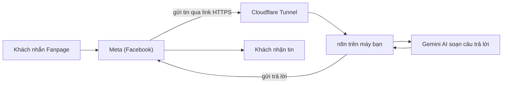

# Hướng dẫn tự làm Chatbot trên Messenger (n8n + Gemini + Fanpage)

Sau khi làm xong, khách nhắn tin vào **Fanpage** của bạn thì chatbot AI sẽ tự trả lời, tư vấn món và chốt đơn. Ví dụ trong hướng dẫn này là tiệm bánh mì, bạn có thể đổi sang ngành khác.

**Thời gian làm:** khoảng 1–2 giờ nếu làm lần đầu.
**Chi phí:** 0đ khi test (n8n, Docker, Cloudflare Tunnel và Gemini bản miễn phí đều không tốn tiền).

---

## 0. Cách chatbot hoạt động



| Thành phần | Vai trò |
|---|---|
| **Fanpage** | Nơi khách nhắn tin |
| **Meta App** | "Cầu nối" cho phép n8n đọc và gửi tin nhắn của Fanpage |
| **n8n** | Phần mềm tự động hóa, chạy luồng xử lý tin nhắn |
| **Docker Desktop** | Công cụ để chạy n8n trên máy tính |
| **Cloudflare Tunnel** | Tạo link internet (HTTPS) trỏ về n8n trên máy bạn, vì Meta không gọi được vào `localhost` |
| **Gemini API** | Bộ não AI soạn câu trả lời |

> [!IMPORTANT]
> **Dùng Fanpage, không dùng tài khoản Facebook cá nhân.** Dùng cookie hay tool tự động trên acc cá nhân vi phạm điều khoản của Facebook, dễ bị khóa. Ngoài ra Messenger cá nhân bị mã hóa đầu cuối nên bot không đọc được tin nhắn.

---

## 1. Chuẩn bị

Bạn cần có:
- Một máy tính Windows, kết nối internet ổn định.
- Một tài khoản Facebook (nên là acc thật hoặc acc đã dùng lâu, acc mới tạo dễ bị Meta hạn chế).
- Một Gmail (để lấy Gemini API key).
- File workflow mẫu: `banhmi-messenger.json` (do người hướng dẫn gửi).

---

## 2. Cài Docker Desktop

1. Vào https://www.docker.com/products/docker-desktop và tải bản cho Windows.
2. Cài đặt như phần mềm bình thường, khởi động lại máy nếu được yêu cầu.
3. Mở **Docker Desktop**, chờ góc dưới bên trái hiện chữ **Engine running** (màu xanh).

---

## 3. Chạy n8n bằng Docker

1. Tạo một thư mục, ví dụ `C:\n8n`.
2. Trong thư mục đó, tạo file tên `docker-compose.yaml` với nội dung sau:

```yaml
services:
  n8n:
    image: docker.io/n8nio/n8n:latest
    container_name: n8n
    restart: unless-stopped
    ports:
      - "5678:5678"
    environment:
      - N8N_RUNNERS_MODE=external
      - N8N_RUNNERS_BROKER_LISTEN_ADDRESS=0.0.0.0
      - N8N_RUNNERS_AUTH_TOKEN=DOI-THANH-MOT-CHUOI-BAT-KY
      - N8N_PROXY_HOPS=1
      # Điền link Cloudflare ở Bước 4 vào dòng dưới, nhớ có dấu / ở cuối
      - WEBHOOK_URL=https://CHUA-CO-LINK.trycloudflare.com/
    volumes:
      - n8n_data:/home/node/.n8n

  runners:
    image: docker.io/n8nio/runners:latest
    container_name: n8n-runners
    restart: unless-stopped
    depends_on:
      - n8n
    environment:
      - N8N_RUNNERS_TASK_BROKER_URI=http://n8n:5679
      - N8N_RUNNERS_AUTH_TOKEN=DOI-THANH-MOT-CHUOI-BAT-KY

volumes:
  n8n_data:
```

> [!WARNING]
> Hai dòng `N8N_RUNNERS_AUTH_TOKEN` (ở `n8n` và `runners`) phải **giống hệt nhau**. Nếu khác nhau, node Code trong workflow sẽ bị lỗi.

3. Mở PowerShell tại thư mục đó: mở thư mục trong File Explorer, bấm vào thanh địa chỉ, gõ `powershell` rồi nhấn Enter.
4. Chạy lệnh:
   ```
   docker compose up -d
   ```
5. Mở trình duyệt vào http://localhost:5678, tạo tài khoản quản trị n8n (email và mật khẩu tự đặt).

---

## 4. Tạo link internet bằng Cloudflare Tunnel

1. Mở **PowerShell** (nhấn Windows, gõ `powershell`).
2. Cài cloudflared (chỉ làm một lần):
   ```
   winget install Cloudflare.cloudflared
   ```
3. **Đóng PowerShell và mở lại**, rồi chạy:
   ```
   cloudflared tunnel --url http://localhost:5678
   ```
4. Trong chữ hiện ra, tìm link dạng `https://xxxx-xxxx-xxxx.trycloudflare.com` và **copy lại**.
   - Có thể thấy dòng `ERROR` trong bảng kiểm tra kết nối, nhưng nếu có dòng `Registered tunnel connection` thì vẫn dùng được.
5. **Giữ nguyên cửa sổ này**, tắt là link chết.
6. Mở lại file `docker-compose.yaml`, thay `https://CHUA-CO-LINK.trycloudflare.com/` bằng link vừa copy (giữ dấu `/` ở cuối), lưu file.
7. Chạy lại n8n trong PowerShell khác, tại thư mục chứa file compose:
   ```
   docker compose up -d
   ```

> [!NOTE]
> Mỗi lần chạy lại `cloudflared`, link sẽ **đổi**. Khi đó phải làm lại bước 6, bước 7 và cập nhật Callback URL ở Bước 8.

---

## 5. Tạo Fanpage

1. Vào Facebook, chọn **Pages → Create new Page** (Tạo trang mới).
2. Đặt tên (ví dụ "Bánh Mì Ngon"), chọn danh mục, bấm **Create Page**.
3. Fanpage không cần đăng bài, chỉ cần tồn tại.

---

## 6. Lấy Gemini API key

1. Vào https://aistudio.google.com/apikey và đăng nhập Gmail.
2. Bấm **Create API key**.
3. Copy chuỗi key và lưu lại ở nơi riêng tư.

---

## 7. Tạo Meta App

1. Vào https://developers.facebook.com và đăng nhập. Nếu là lần đầu, đăng ký tài khoản developer theo hướng dẫn.
2. Bấm **My Apps → Create App**.
3. Điền tên app. Ở bước chọn loại, chọn **Other** rồi chọn loại **Business** (nếu giao diện hỏi use case thì chọn phần liên quan đến **Messenger / Engage with customers on Messenger**).
4. Tạo xong, ở menu bên trái bấm **Add Product** và thêm **Messenger** nếu chưa có.

> [!NOTE]
> Giao diện Meta thay đổi khá thường xuyên nên tên nút có thể khác chút. Hãy tìm mục có chữ **Messenger** và **Webhooks**.

---

## 8. Import workflow vào n8n và nối các phần

### 8.1. Import workflow
1. Trong n8n (http://localhost:5678), tạo workflow mới, bấm dấu **`⋯`** ở góc trên, chọn **Import from File** và chọn `banhmi-messenger.json`.
2. Bạn sẽ thấy hai luồng:
   - Luồng trên (GET): trả lời khi Meta kiểm tra webhook.
   - Luồng dưới (POST): nhận tin nhắn, nhờ AI trả lời, gửi lại khách.

### 8.2. Gắn Gemini API key
1. Bấm đúp vào node **Gemini**.
2. Ở ô **Credential**, chọn **Create new credential**.
3. Dán Gemini API key (Bước 6) rồi bấm **Save**.

### 8.3. Lấy Page Access Token
1. Trong Meta App, vào **Messenger → Messenger API Settings**.
2. Ở mục **Generate access tokens**, bấm **Add or remove Pages**, chọn Fanpage của bạn.
3. Bấm **Generate token**, copy token (chuỗi rất dài).

### 8.4. Dán token vào n8n
1. Bấm đúp vào node **Gửi trả lời**.
2. Tìm giá trị `DIEN_PAGE_ACCESS_TOKEN` và thay bằng token vừa copy.
3. Lưu lại, rồi bấm **Publish** ở góc trên bên phải. Bạn phải Publish thì webhook mới hoạt động, và mỗi lần sửa workflow đều phải Publish lại.

### 8.5. Kết nối Webhook với Meta
1. Trong **Messenger API Settings**, mục **Configure webhooks**:
   - **Callback URL:** `https://<link-cloudflare-của-bạn>/webhook/messenger`
   - **Verify token:** `banhmi123` (có thể đổi, nhưng phải đổi cả trong node **Token đúng?** của n8n)
   - Tắt mục **Attach a client certificate** nếu đang bật.
2. Bấm **Verify and save**.
3. Ở dòng Fanpage bên dưới, bấm **Add subscriptions** và tích chọn **`messages`**, rồi lưu.

### 8.6. Nhắn thử
1. Dùng tài khoản Facebook đã tạo app (hoặc tài khoản được thêm vào **App roles** của app), nhắn tin vào Fanpage: "cho mình xem menu".
2. Bot sẽ trả lời. Nếu không, xem phần **Xử lý lỗi** bên dưới.

---

## 9. Đổi thành chatbot riêng của bạn

1. Mở node **AI Agent** và sửa phần **System Message**. Đây là "kịch bản" của bot. Đổi:
   - Tên tiệm, vai trò, cách xưng hô.
   - Menu, giá, mô tả món.
   - Quy trình chốt đơn, các quy tắc bắt buộc.
2. Bấm **Publish** lại để áp dụng.

**Mẹo viết kịch bản tốt:**
- Ghi rõ "chỉ bán các món trong menu, không bịa thêm món".
- Dặn bot trả lời ngắn gọn, không dùng ký hiệu in đậm (`**`) vì Messenger không hiển thị.
- Dặn bot tính tiền cẩn thận, xác nhận lại đơn trước khi chốt.

---

## 10. Xử lý lỗi thường gặp

| Hiện tượng | Nguyên nhân và cách xử lý |
|---|---|
| Meta báo *"Callback URL or verify token couldn't be validated"* | Workflow chưa Publish, hoặc link Cloudflare đã đổi, hoặc `WEBHOOK_URL` chưa đúng. Kiểm tra lại Bước 4 và 8.4. |
| Mở link trycloudflare báo *error code 1033* | Cloudflare Tunnel đã tắt. Chạy lại `cloudflared`. |
| Nhắn tin mà n8n không có lượt chạy mới (tab **Executions**) | Chưa tích **`messages`** ở Add subscriptions, hoặc người nhắn chưa có vai trò trong app (xem phần Lưu ý). |
| Lượt chạy màu đỏ ở node **Lấy tin nhắn** | Hai `N8N_RUNNERS_AUTH_TOKEN` chưa giống nhau, hoặc runners chưa chạy. |
| Lỗi ở node **AI Agent** | Gemini key sai hoặc hết hạn mức miễn phí. Tạo key mới hoặc đợi hạn mức làm mới. |
| Lỗi ở node **Gửi trả lời** | Page token sai hoặc hết hạn. Tạo lại token ở Bước 8.3. |
| Sửa workflow mà bot vẫn cũ | Quên bấm **Publish**. |

---

## 11. Lưu ý quan trọng

- **App ở chế độ Development:** chỉ Admin, Developer, Tester của app mới được bot trả lời. Thêm người test ở **App roles → Roles**.
- **Muốn khách thật nhắn được:** phải chuyển app sang chế độ **Live** và gửi Meta duyệt quyền `pages_messaging`. Việc này cần có chính sách quyền riêng tư (Privacy Policy URL) và video demo, có thể mất vài ngày.
- **Tunnel tạm thời:** link `trycloudflare.com` đổi mỗi lần chạy lại, phù hợp để học và test. Muốn chạy thật lâu dài, hãy dùng named tunnel có domain riêng hoặc đưa n8n lên VPS.
- **Máy tính phải bật:** tắt máy, tắt Docker hoặc tắt cửa sổ cloudflared thì bot ngừng.
- **Bảo mật:** không gửi Page token, Gemini key và App Secret lên nhóm chat hay đăng công khai. Nếu lỡ lộ, hãy tạo lại token và key mới.
- Bot hiện chỉ **ghi nhận đơn qua tin nhắn**, chưa tự báo cho chủ tiệm. Muốn báo đơn qua Telegram, Zalo hoặc Google Sheets, bạn thêm node tương ứng trong n8n.

---

## Danh sách kiểm tra nhanh

- [ ] Docker Desktop đang chạy
- [ ] n8n mở được ở http://localhost:5678
- [ ] Cloudflare Tunnel đang chạy, link đã dán vào `WEBHOOK_URL`
- [ ] Có Fanpage
- [ ] Có Gemini API key, đã gắn vào node **Gemini**
- [ ] Có Meta App, đã lấy Page token và dán vào node **Gửi trả lời**
- [ ] Đã **Publish** workflow
- [ ] Webhook Meta: **Verify and save** thành công, đã subscribe `messages`
- [ ] Nhắn thử vào Fanpage và bot trả lời
